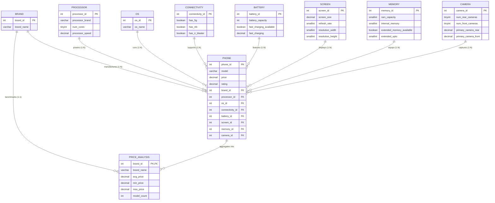

# Entity-Relationship (ER) Diagram
**Project:** SQL & NoSQL Mobile Catalog Analysis (NMIMS Mumbai)

This directory contains the complete structural data models for the 10-entity database.

---

## 1. Visual Diagram

*The high-resolution diagram above is located at:* `docs/er_diagram/er_diagram.png`

---

## 2. Interactive / dbdiagram.io Code

We have provided the complete DBML schema in [`schema.dbml`](schema.dbml).

**How to use:**
1. Open [dbdiagram.io](https://dbdiagram.io) in your browser.
2. Paste the contents of `schema.dbml`.
3. You can interactively pan, zoom, rearrange tables, and export in SVG/PDF/PNG formats.

---

## 3. Schema Structure & Cardinality

The architecture follows **Third Normal Form (3NF)** with a centralized **Fact Table (`phone`)** surrounded by 8 dimension tables and 1 summary analytics table:

